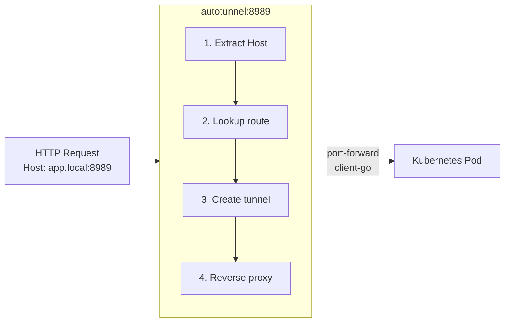

```
 █████╗ ██╗   ██╗████████╗ ██████╗ ████████╗██╗   ██╗███╗   ██╗███╗   ██╗███████╗██╗
██╔══██╗██║   ██║╚══██╔══╝██╔═══██╗╚══██╔══╝██║   ██║████╗  ██║████╗  ██║██╔════╝██║
███████║██║   ██║   ██║   ██║   ██║   ██║   ██║   ██║██╔██╗ ██║██╔██╗ ██║█████╗  ██║
██╔══██║██║   ██║   ██║   ██║   ██║   ██║   ██║   ██║██║╚██╗██║██║╚██╗██║██╔══╝  ██║
██║  ██║╚██████╔╝   ██║   ╚██████╔╝   ██║   ╚██████╔╝██║ ╚████║██║ ╚████║███████╗███████╗
╚═╝  ╚═╝ ╚═════╝    ╚═╝    ╚═════╝    ╚═╝    ╚═════╝ ╚═╝  ╚═══╝╚═╝  ╚═══╝╚══════╝╚══════╝
```

# autotunnel - On-Demand Port Forwarder & Tunnel

A lightweight, auto and on-demand (lazy) port-forwarding proxy to Kubernetes. Tunnels are created lazily when traffic arrives to the local port and torn down after an idle timeout. Currently supports Kubernetes services and pods.

## Summary

Connect to Kubernetes services and pods with friendly URLs automatically:

* `http://nginx-80.svc.default.ns.microk8s.cx.k8s.localhost:8989` — Dynamic routing (opt-in with `dynamic_host`, no per-service config; see the [Security Note](#security-note))
* `https://argocd.localhost:8989` — Pre-configured route

### Features

* **On-demand tunneling** - port-forwards are created automatically when traffic arrives
* **HTTP and HTTPS support** - HTTP reverse proxy with `X-Forwarded-*` headers, TLS passthrough for HTTPS
* 💥 **TCP port forwarding** 🆕 - on-demand forward non-HTTP protocols (databases, Redis, etc.) to K8s services/pods
* 💥 **Jump-host routing** 🆕 - reach VPC-internal services on-demand (RDS, Cloud SQL) through a jump pod
* **Auto-create jump pods** 🆕 - automatically create jump pods on-demand
* **K8s Services and Pods** - target either directly or let it discover pods via service selectors
* **Protocol multiplexing** - serve both HTTP and HTTPS on a single port
* **Idle cleanup** - tunnels automatically close after configurable idle timeout
* **Native client-go** - uses Kubernetes client library directly (no kubectl subprocess)


## Installation

### Homebrew (macOS/Linux)

```bash
brew install atas/tap/autotunnel
brew services start autotunnel    # Start and enable auto-start on login
# Or run manually
# autotunnel
```

**After starting it, edit the created config file `~/.autotunnel.yaml` with an editor to add your custom routes / kubeconfig paths.**  
The config auto-reloads on save unless port changes, then `brew services restart autotunnel` is required.

#### Logs
```bash
tail -f $(brew --prefix)/var/log/autotunnel.log
```

<details>
<summary><strong>Other useful commands</strong></summary>

```bash
brew services stop autotunnel       # Stop the service
brew services info autotunnel       # Show information about the service
brew services restart autotunnel    # Restart the service
brew services uninstall autotunnel  # Uninstall the service
brew services list                  # Check status
```

</details>

<details>
<summary><strong>Linux (systemd)</strong></summary>

```bash
# Copy the service file (included in release archives)
mkdir -p ~/.config/systemd/user
cp autotunnel.service ~/.config/systemd/user/

# Enable and start
systemctl --user daemon-reload
systemctl --user enable --now autotunnel

# Check status and logs
systemctl --user status autotunnel
journalctl --user -u autotunnel -f
```

</details>

<details>
<summary>Go Install</summary>

```bash
go install github.com/atas/autotunnel@latest
```

Download the latest release from the [releases page](https://github.com/atas/autotunnel/releases).
</details>

## Quick Start

1. Run autotunnel, either manually or as a service. It will generate a default config file:

```bash
brew services start autotunnel #or just run `autotunnel` manually
# Creates ~/.autotunnel.yaml with example configuration
```

2. Edit `~/.autotunnel.yaml` with your services:

3. It will auto-reload unless port changes.

```yaml
apiVersion: autotunnel/v1

# Verbose logging (can also use --verbose flag with higher priority)
# verbose: false

# Auto-reload on file changes. Any changes need `brew services restart autotunnel` while it is false.
auto_reload_config: true

# Common paths (/usr/local/bin, /opt/homebrew/bin, etc.) are added automatically.
# Add custom paths here if your credential plugin is in a non-standard location.
# exec_path:
#   - /custom/path/to/binaries

http:
   # Listen address - handles both HTTP and HTTPS (TLS passthrough) on same port
   listen: "127.0.0.1:8989" # Port changes require: brew services restart autotunnel

   # Idle timeout before closing tunnels (Go duration format)
   # After this duration of no traffic, the tunnel will be closed
   idle_timeout: 60m

   k8s:
      # Path(s) to kubeconfig. Supports colon-separated paths like $KUBECONFIG.
      # Defaults to ~/.kube/config. Run `echo $KUBECONFIG` to see your value.
      # kubeconfig: ~/.kube/config:~/.kube/prod-config

      # Dynamic routing: access any K8s service or pod without pre-configuring routes
      # Off by default. Read the Security Note below before enabling it.
      # Formats:
      #   Service: {service}-{port}.svc.{namespace}.ns.{context}.cx.{dynamic_host}
      #   Pod:     {pod}-{port}.pod.{namespace}.ns.{context}.cx.{dynamic_host}
      # Examples:
      #   http://nginx-80.svc.default.ns.my-cluster-context.cx.k8s.localhost:8989
      #   https://argocd-server-443.svc.argocd.ns.my-cluster-context.cx.k8s.localhost:8989
      #   http://nginx-2fxac-80.pod.default.ns.my-cluster-context.cx.k8s.localhost:8989
      # dynamic_host: k8s.localhost
      # dynamic_contexts: [docker-desktop, my-dev-cluster] # Optional. Default is any context.

      routes:
         # Static routes (take priority over dynamic routing)

         # https://argocd.localhost:8989 (also supports http, http://argocd.localhost:8989)
         argocd.localhost:
           context: my-cluster-context # Kubernetes context name from kubeconfig
           namespace: argocd           # Kubernetes namespace
           service: argocd-server      # Kubernetes service name
           port: 443                   # Service port (automatically resolves to container targetPort)
           scheme: https               # Optional. Default is http.
                                       # You can access remote https via local http too, not the other way around.

# TCP tunneling for non-HTTP protocols (databases, caches, etc.)
# For this section, we need an available and unique local port for each mapping.
tcp:
   k8s:
      routes:
         # # PostgreSQL: connect via localhost:5432
         # 5432: # local port
         #   context: my-cluster-context
         #   namespace: databases
         #   service: postgresql
         #   port: 5432 # remote port

      # Jump-host routes via kubectl exec + socat/nc
      # Use this to connect to VPC-internal services (RDS, Cloud SQL, etc.)
      # through a jump pod that has network access to those services.
      # ! NEED socat or nc (netcat) installed in the jump pod.
      jump:
         # # AWS RDS via existing pod (discovered from service)
         # 3306: # local port
         #   context: my-cluster-context
         #   namespace: default
         #   via:
         #     service: backend-api   # Use pod from this service
         #   target:
         #     host: mydb.rds.amazonaws.com
         #     port: 3306

         # # Redis via auto-created jump pod
         # 6380: # local port
         #   context: my-cluster-context
         #   namespace: default
         #   via:
         #     pod: autotunnel-jump
         #     create: # Optional, auto-create if there is no pod with socat/nc you can use
         #       image: alpine/socat:latest
         #       # command: ["sleep", "infinity"]  # Optional: custom idle command (default: ["sleep", "infinity"])
         #   target:
         #     host: my-redis.cache.amazonaws.com
         #     port: 6379
```

3. Run autotunnel:

```bash
autotunnel
```

4. Access your services:

```bash
# HTTP/HTTPS routes
curl -k https://argocd.localhost:8989/
curl http://grafana.localhost:8989/

# TCP routes (if configured)
psql -h localhost -p 5432 -U postgres
redis-cli -p 6379
```

## How It Works (k8s example)



1. User configures hostname → K8s service/pod mappings in YAML config
2. autotunnel listens on a single local port (e.g., 8989)
3. When a request arrives, it inspects the `Host` header (HTTP) or SNI (TLS)
4. If no tunnel exists for that host, it creates a port-forward using client-go
5. It reverse-proxies the request through the tunnel
6. After an idle timeout (no traffic), it closes the tunnel

## Configuration

Configuration file location: `~/.autotunnel.yaml` (or specify with `--config`)

```yaml
apiVersion: autotunnel/v1

# verbose: true  # Enable verbose logging (or use --verbose flag)

# Auto-reload on file changes (disable requires: brew services restart autotunnel)
auto_reload_config: true

# Additional paths for exec credential plugins (e.g., aws-iam-authenticator, gcloud)
# Common paths (/usr/local/bin, /opt/homebrew/bin, etc.) are added automatically.
# exec_path:
#   - /custom/path/to/binaries

http:
  # Listen address (handles both HTTP and HTTPS on same port)
  listen: "127.0.0.1:8989"  # Port changes require: brew services restart autotunnel

  # Idle timeout before closing tunnels (Go duration format)
  idle_timeout: 60m

  k8s:
    # Path(s) to kubeconfig. Supports colon-separated paths like $KUBECONFIG.
    # Defaults to ~/.kube/config. Run `echo $KUBECONFIG` to see your value.
    # kubeconfig: ~/.kube/config:~/.kube/prod-config

    routes:
      # Route via service (discovers pod automatically)
      argocd.localhost:
        context: microk8s           # Kubernetes context from kubeconfig
        namespace: argocd           # Kubernetes namespace
        service: argocd-server      # Kubernetes service name
        port: 443                   # Service port
        scheme: https               # Sets X-Forwarded-Proto header

      grafana.localhost:
        context: microk8s
        namespace: observability
        service: grafana
        port: 3000

      # Route directly to a pod (no pod discovery)
      debug.localhost:
        context: microk8s
        namespace: default
        pod: my-debug-pod           # Pod name (use instead of service)
        port: 8080

# TCP tunneling for non-HTTP protocols (databases, caches, etc.)
# Each route listens on a local port and forwards to a K8s service/pod
tcp:
  idle_timeout: 60m  # Optional, defaults to http.idle_timeout

  k8s:
    # kubeconfig: ~/.kube/config  # Optional, same format as http.k8s.kubeconfig

    # Direct port-forward routes (native K8s port-forward)
    routes:
      # PostgreSQL: connect via localhost:5432
      5432:
        context: microk8s
        namespace: databases
        service: postgresql
        port: 5432

      # Redis: connect via localhost:6379
      6379:
        context: microk8s
        namespace: caching
        service: redis-master
        port: 6379

      # Direct pod targeting (no service discovery)
      27017:
        context: microk8s
        namespace: databases
        pod: mongodb-0
        port: 27017

    # Jump-host routes for VPC-internal services (RDS, Cloud SQL, etc.)
    # Connects through a jump pod that has network access to the target.
    # ! NEED socat or nc (netcat) installed in the jump pod.
    jump:
      # AWS RDS MySQL via existing jump pod
      3306:
        context: eks-prod
        namespace: default
        via:
          service: backend-api # Discover pod from service selector
          # pod: bastion-pod # OR use direct pod instead of service
          # container: main  # Optional: for multi-container pods
        target:
          host: mydb.cluster-xyz.us-east-1.rds.amazonaws.com
          port: 3306

      # Cloud SQL via auto-created jump pod
      5433:
        context: gke-prod
        namespace: default
        via:
          pod: autotunnel-jump      # Pod name to create & re-use
          create:
            image: alpine/socat:latest  # Auto-create pod with this image
            # command: ["sleep", "infinity"]  # Optional: custom idle command (default: ["sleep", "infinity"])
            # timeout: 60s  # Optional: pod readiness timeout (default: 60s)
        target:
          host: 10.0.0.5            # VPC-internal IP
          port: 5432
        method: socat               # Optional: "socat" (default), nc is automatic fallback
```

### HTTP Route Options

Each route requires either `service` or `pod` (mutually exclusive):

| Field       | Description                                                 |
| ----------- | ----------------------------------------------------------- |
| `context`   | Kubernetes context name from kubeconfig                     |
| `namespace` | Kubernetes namespace                                        |
| `service`   | Service name (autotunnel discovers a ready pod)             |
| `pod`       | Pod name (direct targeting, no discovery)                   |
| `port`      | Service or pod port                                         |
| `scheme`    | `http` (default) or `https` - sets X-Forwarded-Proto header |

### Dynamic Routing Options

Set under `http.k8s`. Dynamic routing stays off until `dynamic_host` is set; read the [Security Note](#security-note) first.

| Field              | Description                                                                                           |
| ------------------ | ----------------------------------------------------------------------------------------------------- |
| `dynamic_host`     | Hostname suffix that turns on dynamic routing, e.g. `k8s.localhost`                                   |
| `dynamic_contexts` | Optional list of kubeconfig contexts dynamic routing may use, matched exactly. Empty means any context |

A dynamic hostname must use valid Kubernetes names in lowercase and a plain port number: `nginx-080` is not an alias for `nginx-80`.

### TCP Route Options

Direct port-forward to K8s services/pods. Each route requires either `service` or `pod`:

| Field       | Description                               |
| ----------- | ----------------------------------------- |
| `context`   | Kubernetes context name from kubeconfig   |
| `namespace` | Kubernetes namespace                      |
| `service`   | Service name (discovers a ready pod)      |
| `pod`       | Pod name (direct targeting, no discovery) |
| `port`      | Target port on the service/pod            |

Usage:
```bash
psql -h localhost -p 5432 -U postgres
redis-cli -p 6379
```

### TCP Jump Route Options

Connect to VPC-internal services through a jump pod. Requires `socat` or `nc` in the jump pod.

| Field                | Description                                                             |
| -------------------- | ----------------------------------------------------------------------- |
| `context`            | Kubernetes context name                                                 |
| `namespace`          | Kubernetes namespace                                                    |
| `via.service`        | Service to discover jump pod from (mutually exclusive with `via.pod`)   |
| `via.pod`            | Direct jump pod name (mutually exclusive with `via.service`)            |
| `via.container`      | Container name (optional, for multi-container pods)                     |
| `via.create.image`   | Image for auto-creating jump pod (requires `via.pod`)                   |
| `via.create.timeout` | Pod readiness timeout (default: 60s)                                    |
| `target.host`        | Target hostname or IP (e.g., RDS endpoint)                              |
| `target.port`        | Target port                                                             |
| `method`             | `socat` (default) - forwarding method in jump pod (nc is auto-fallback) |

Auto-created pods have labels `app.kubernetes.io/managed-by: autotunnel`. Clean up with:
```bash
kubectl delete pod -l app.kubernetes.io/managed-by=autotunnel
```

## CLI Options

```
Usage: autotunnel [options]

Options:
  -config string
        Path to configuration file (default "~/.autotunnel.yaml")
  -verbose
        Enable verbose logging
  -version
        Show version information
```

## Using with *.localhost

On most systems, `*.localhost` resolves to `127.0.0.1` automatically. This makes it easy to use autotunnel without modifying `/etc/hosts`:

```yaml
http:
  k8s:
    routes:
      myapp.localhost:
        # ...
```

Then access via: `http://myapp.localhost:8989/`

## Using with /etc/hosts

For custom hostnames, add entries to `/etc/hosts`:

```
127.0.0.1  myapp.local
127.0.0.1  api.local
```

## Security Note

**autotunnel has no authentication.** Any process on your machine and any web page in your browser that can reach the listen port acts with your kubeconfig credentials. RBAC does not limit this, because your RBAC access is exactly what is being lent out. Keep `http.listen` on a loopback address, and use caution with contexts that reach production.

**Static routes** reach only what you listed, and you configured them deliberately. They get none of the checks below: a page can send them requests, the same exposure as a port opened by `kubectl port-forward`.

**Dynamic routing** is more exposed, because the hostname picks the context, namespace and target, so everything your credentials can reach is in play. It is off until you opt in, and limiting it to contexts you accept this for is recommended:

```yaml
http:
  k8s:
    dynamic_host: k8s.localhost
    dynamic_contexts: [docker-desktop, my-dev-cluster]
```

On dynamic hostnames autotunnel does the following:

* `dynamic_contexts` refuses other contexts for HTTP and HTTPS alike, before any Kubernetes client is built.
* Plain HTTP requests get a 403 when another page made them, WebSocket upgrades included. That means `Sec-Fetch-Site: cross-site` or `same-site` unless the request is a top-level GET or HEAD navigation, and any `Origin` whose host differs from `Host`, including `Origin: null`.
* Plain HTTP responses lose the `Domain` attribute from `Set-Cookie`, so a backend's cookies stay on its own hostname.

These checks do not cover everything:

* **Local processes.** curl and scripts send neither header and pass. Only `dynamic_contexts`, or leaving dynamic routing off, limits them.
* **Links and redirects.** Another page can still navigate your browser to a dynamic hostname with GET. That opens a tunnel and runs whatever the backend does on that GET.
* **HTTPS.** TLS passthrough never sees the request or response, so only `dynamic_contexts` applies.
* **Other hostnames.** Browsers send `Sec-Fetch-*` only to HTTPS and localhost-style hosts. With a `dynamic_host` such as `lvh.me` over plain HTTP, only the `Origin` check runs, and a cross-site GET such as an image does not carry `Origin`.
* **Cookies set from script.** All dynamic hostnames share one site, so a page on one can still set cookies for the others with `document.cookie`. Static routes on separate `*.localhost` names do not share a site.

The checks can also refuse legitimate requests. An app whose page calls an API on a different dynamic hostname gets a 403, and so does a same-origin POST from a page with `Referrer-Policy: no-referrer`, since browsers send it with `Origin: null`. Use static routes for those apps.

## Development

### Building

```bash
go build -o autotunnel .
```

### Running Tests

```bash
go test -v ./...
```

### Creating a Release

Releases are automated via GoReleaser. Push a tag to trigger:

```bash
git tag v0.1.0
git push origin v0.1.0
```

## License

MIT License - see [LICENSE](LICENSE) for details.
